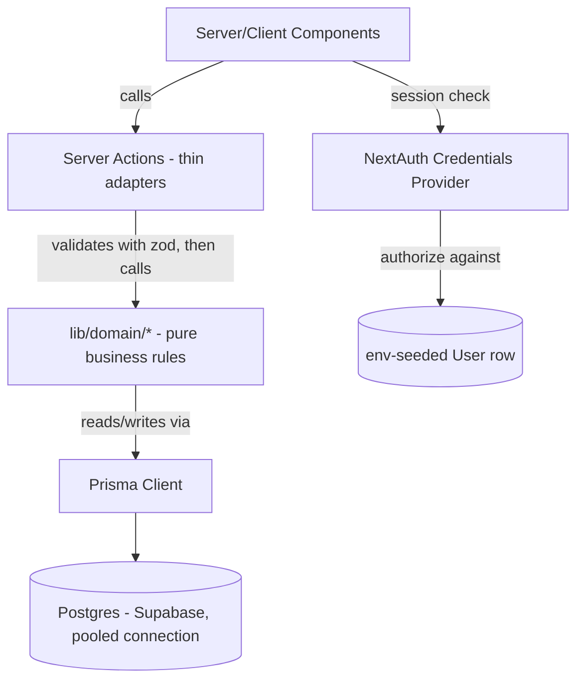
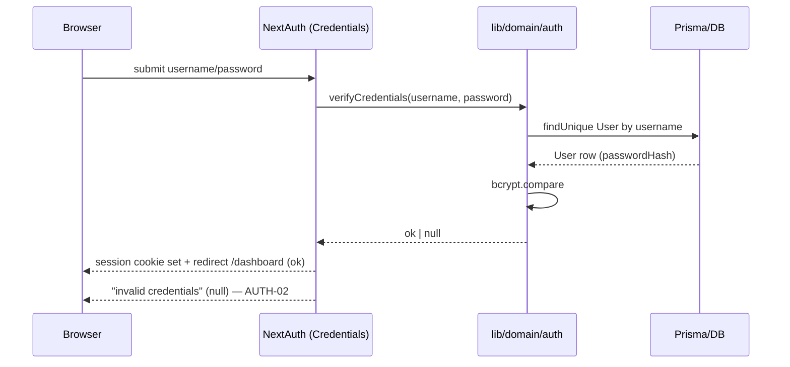
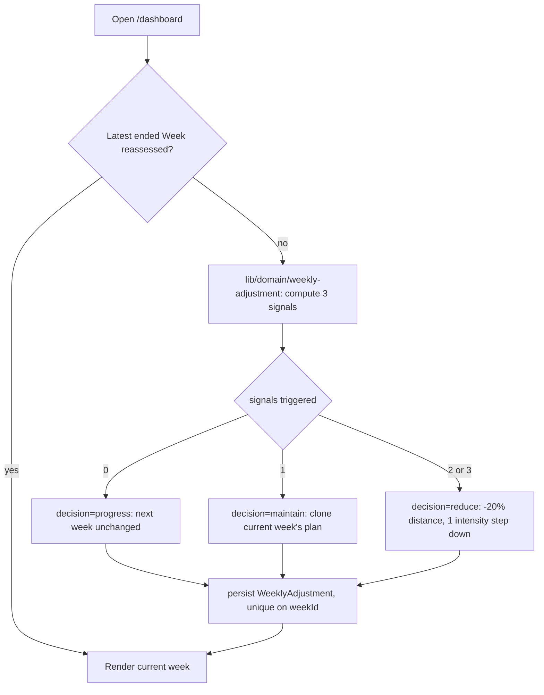
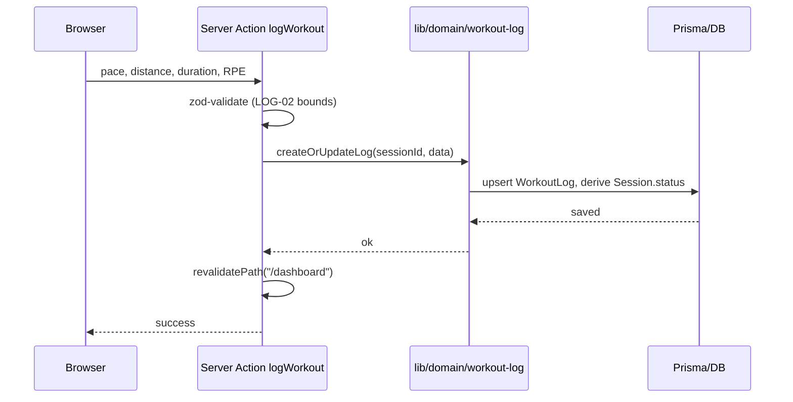

# Coach Virtual Design

**Spec**: `.specs/features/coach-virtual/spec.md`
**Status**: Approved - 2026-11-05 - user: "aprovado"

---

## Approach Exploration

Three viable approaches were presented; the user confirmed **Server Actions + domínio em
`lib/domain/` + NextAuth** (Credentials Provider against env-seeded credentials). Rejected:
(1) REST API Routes instead of Server Actions — more boilerplate, no second client planned for
v1; (2) hand-rolled signed-cookie session instead of NextAuth — more security-sensitive code to
write and maintain ourselves for no real benefit with a single account.

---

## Architecture Overview

Layered: UI (Server/Client Components) → thin **Server Actions** → **domain services**
(`lib/domain/*`, framework-agnostic, unit-tested directly) → **Prisma Client** → **Postgres
(Supabase)**. This satisfies the "where rules run" requirement: every rule that changes what the
user sees (plan generation, pace calculation, the 3-signal adjustment, status transitions) lives
in `lib/domain/*`, not in a Server Action or a component, so the project's own test suite reaches
it directly without going through HTTP or rendering.



**Login** (`AUTH-01..05`):



**Dashboard load with lazy weekly reassessment** (`DASH-04`, `ADJ-01..06`):



**Log workout** (`LOG-01..05`):



---

## Code Reuse Analysis

Greenfield project — no existing code to reuse. The first implementation task is the project
scaffold itself (Next.js + Prisma + Supabase + NextAuth wiring); every later task builds inside
that scaffold's conventions.

### Integration Points

| System | Integration Method |
| --- | --- |
| Supabase Postgres | Prisma `datasource db`: pooled `DATABASE_URL` (port 6543, PgBouncer transaction mode) for app queries, separate `DIRECT_URL` (port 5432) for `prisma migrate` — PgBouncer in transaction mode does not support the migration engine. [Prisma+PgBouncer pattern](https://community.redwoodjs.com/t/guide-migrations-connection-pool-urls-supabase/2505), [Supabase pooling on Vercel](https://dev.to/mahdi_benrhouma_fe1c6005/supabase-connection-pooling-with-pgbouncer-on-vercel-serverless-1o33) |
| NextAuth.js | Credentials Provider; `authorize()` calls `lib/domain/auth.verifyCredentials`, which reads the single seeded `User` row. No OAuth, no registration page. |
| Vercel | Standard Next.js App Router deployment; env vars (`DATABASE_URL`, `DIRECT_URL`, `NEXTAUTH_SECRET`, seed credentials) set in project settings. |

---

## Components

### `lib/domain/vdot.ts`

- **Purpose**: VDOT formula (Jack Daniels) and derived training-pace tables.
- **Location**: `lib/domain/vdot.ts`
- **Interfaces**:
  - `calculateVdot(distanceKm: number, timeSec: number): number` — `VDOT-03`, `LIFE-03`
  - `paceForVdot(vdot: number, sessionType: SessionType): { secPerKm: number }` — `PLAN-07`
  - `isPlausibleResult(distanceKm: number, timeSec: number): boolean` — rejects physically
    impossible test/race times (Edge Cases)
- **Dependencies**: none (pure functions)
- **Reuses**: n/a (greenfield)

### `lib/domain/plan-generator.ts`

- **Purpose**: Computes plan length, phase split, and generates `Week`/`Session` rows for a new
  or recalculated plan.
- **Location**: `lib/domain/plan-generator.ts`
- **Interfaces**:
  - `computePlanWeeks(raceType: RaceType, raceDate: Date, today: Date): { weeks: number; belowMinimum: boolean }` — `PLAN-01`, `PLAN-02`
  - `splitPhases(totalWeeks: number): PhaseAssignment[]` — taper `ceil(10%)` clamped `[1,3]`, rest
    base 40/build 35/peak 25 — `PLAN-05`
  - `generateSessions(week: PhaseAssignment, days: Weekday[], vdot: number): SessionDraft[]` —
    `PLAN-03`, `PLAN-06`, `PLAN-07`
  - `validateDaysPerWeek(days: Weekday[]): boolean` — 3–6 only, `PLAN-04`
- **Dependencies**: `vdot.ts` for pace calculation
- **Reuses**: n/a

### `lib/domain/weekly-adjustment.ts`

- **Purpose**: Computes the 3 fatigue signals for an ended week and the reduce/maintain/progress
  decision, and regenerates the following week's sessions accordingly.
- **Location**: `lib/domain/weekly-adjustment.ts`
- **Interfaces**:
  - `computeSignals(week: WeekWithLogs): { paceDeviation: boolean; rpe: boolean; missed: boolean }` — `ADJ-01`
  - `decide(signals): 'reduce' | 'maintain' | 'progress'` — `ADJ-02..04`
  - `applyDecision(decision, nextWeekDraft): SessionDraft[]` — `ADJ-02..04`
  - `reassessIfDue(weekId: string): Promise<WeeklyAdjustment | null>` — idempotent, `ADJ-06`
- **Dependencies**: Prisma Client (reads logs, writes `WeeklyAdjustment` + regenerated sessions)
- **Reuses**: `plan-generator.ts`'s session-shape types

### `lib/domain/plan-lifecycle.ts`

- **Purpose**: Plan archival on race-date passing, race-result capture, new-plan VDOT carry-over,
  and in-progress plan edits (recalculation from current week forward).
- **Location**: `lib/domain/plan-lifecycle.ts`
- **Interfaces**:
  - `archiveIfPast(planId: string, today: Date): Promise<void>` — `LIFE-01`
  - `recordRaceResult(planId: string, finishTimeSec: number): Promise<VdotHistory>` — `LIFE-03`
  - `initialVdotForNewPlan(previousPlanId?: string): Promise<number>` — `LIFE-04`, `LIFE-05`
  - `recalculateFromCurrentWeek(planId: string, changes: { raceDate?: Date; days?: Weekday[] }): Promise<void>` — `EDIT-01..03`, `SET-02`
- **Dependencies**: `plan-generator.ts` (regeneration), Prisma Client
- **Reuses**: `plan-generator.ts`

### `lib/domain/auth.ts`

- **Purpose**: Verifies submitted credentials against the single seeded account.
- **Location**: `lib/domain/auth.ts`
- **Interfaces**:
  - `verifyCredentials(username: string, password: string): Promise<{ id: string } | null>` — `AUTH-01`, `AUTH-02`
- **Dependencies**: Prisma Client, bcrypt
- **Reuses**: n/a

### Server Actions (`app/**/actions.ts`)

- **Purpose**: Thin adapters — zod-validate input, call the matching `lib/domain` function,
  `revalidatePath`. No business logic lives here.
- **Location**: colocated per route, e.g. `app/dashboard/actions.ts`, `app/plan/new/actions.ts`
- **Dependencies**: `lib/domain/*`
- **Reuses**: `lib/domain/*`

---

## Data Models

```typescript
enum RaceType { FIVE_K, TEN_K, HALF, MARATHON }
enum PlanStatus { ACTIVE, ARCHIVED }
enum VdotSource { TEST, MANUAL, RACE, RECALC }
enum Phase { BASE, BUILD, PEAK, TAPER }
enum SessionType { EASY, LONG, TEMPO, INTERVAL }
enum Decision { REDUCE, MAINTAIN, PROGRESS }
enum SessionStatus { PENDING, DONE, MISSED } // derived, not stored as a free-standing flag

interface User {
  id: string
  username: string
  passwordHash: string
  createdAt: Date
}

interface Plan {
  id: string
  userId: string
  raceType: RaceType
  raceDate: Date
  startDate: Date
  daysPerWeek: number[] // weekday ints 0-6, length 3-6 (PLAN-04)
  status: PlanStatus // 2 states only — see spec Assumptions
  initialVdot: number
  currentVdot: number
  createdAt: Date
}

interface VdotHistory {
  id: string
  planId: string
  date: Date
  vdot: number
  source: VdotSource
}

interface Week {
  id: string
  planId: string
  weekNumber: number
  phase: Phase
  startDate: Date
  endDate: Date
  reassessedAt: Date | null // null = not yet reassessed, drives ADJ-06 idempotency
}

interface Session {
  id: string
  weekId: string
  type: SessionType
  date: Date
  plannedPaceSecPerKm: number
  plannedDistanceKm: number | null
  plannedDurationMin: number | null
  // status is derived: DONE if a WorkoutLog exists, MISSED if date < today and none exists,
  // PENDING otherwise (spec Assumptions: "Session.status = missed" detection)
}

interface WorkoutLog {
  id: string
  sessionId: string // unique — one log per session
  actualPaceSecPerKm: number
  actualDistanceKm: number
  actualDurationMin: number
  rpe: number // 1-10
  notes: string | null
  loggedAt: Date
}

interface WeeklyAdjustment {
  id: string
  weekId: string // unique — enforces ADJ-06 at the DB level
  paceDeviationTriggered: boolean
  rpeTriggered: boolean
  missedTriggered: boolean
  decision: Decision
  adjustmentPct: number // -20 for reduce, 0 for maintain/progress
  computedAt: Date
}

interface RaceResult {
  id: string
  planId: string // unique — one result per plan
  finishTimeSec: number
  date: Date
  vdotComputed: number
}
```

**Relationships**: `User 1—N Plan`; `Plan 1—N VdotHistory`; `Plan 1—N Week`; `Week 1—N Session`;
`Session 1—0/1 WorkoutLog`; `Week 1—0/1 WeeklyAdjustment`; `Plan 1—0/1 RaceResult`.

**DB-level safety nets** (beyond app logic):
- Partial unique index on `Plan (userId) WHERE status = 'ACTIVE'` — backs `LIFE-06` even if app
  logic has a bug.
- Unique constraint on `WeeklyAdjustment.weekId` and on `WorkoutLog.sessionId` — backs `ADJ-06`
  and prevents duplicate logs per session at the DB level, not just in app logic.

---

## Error Handling Strategy

| Error Scenario | Handling | User Impact |
| --- | --- | --- |
| Invalid login credentials | `verifyCredentials` returns `null`; NextAuth returns a generic auth error | Generic "invalid credentials" message (`AUTH-02`), no field-specific hint |
| Invalid workout log input (out-of-bounds pace/distance/duration/RPE) | zod schema rejects before reaching `lib/domain`; Server Action returns field-level errors | Form shows which field is invalid (`LOG-02`) |
| Plan creation with days-per-week outside 3–6 | `validateDaysPerWeek` rejects; Server Action surfaces the message | Explanation of the 3–6 range (`PLAN-04`) |
| Plan length below recommended minimum | Not rejected — `computePlanWeeks` flags `belowMinimum: true`, plan still generated | Visible warning banner naming the shortfall (`PLAN-02`) |
| DB write failure (transient) | Server Action catches, returns a generic failure; no partial writes (Prisma transaction wraps multi-row generation) | Error toast, user can retry — no silent partial plan |
| Physically implausible VDOT test/race time | `isPlausibleResult` rejects before `calculateVdot` runs | Same validation-class error as `LOG-02` (Edge Cases) |
| Double weekly reassessment (e.g. two tabs) | `Week.reassessedAt` checked before computing; DB unique constraint on `WeeklyAdjustment.weekId` is the final backstop | Second attempt no-ops silently (`ADJ-06`) |

---

## Risks & Concerns

| Concern | Location (file:line) | Impact | Mitigation |
| --- | --- | --- | --- |
| Prisma + Supabase serverless connection exhaustion if the pooled URL isn't used for runtime queries | `prisma/schema.prisma` (datasource block, to be created) | Under concurrent requests (even single-user, Vercel can spin multiple lambda instances), direct (non-pooled) connections can exhaust Supabase's connection limit, causing intermittent 500s | Use pooled `DATABASE_URL` (port 6543, PgBouncer transaction mode) for the app and `DIRECT_URL` (port 5432) for `prisma migrate`; global Prisma Client singleton to avoid connection leaks on dev hot-reload. [source](https://dev.to/mahdi_benrhouma_fe1c6005/supabase-connection-pooling-with-pgbouncer-on-vercel-serverless-1o33) |
| Server Actions are harder to unit-test in isolation than plain functions | all `app/**/actions.ts` (to be created) | A bug in business logic could ship untested if logic lived inside the action itself | All business logic lives in `lib/domain/*`, which is imported and unit-tested directly (e.g. Vitest); Server Actions stay thin enough that they need no logic-level tests of their own |
| Lazy, on-read weekly reassessment could be skipped entirely if the user never opens the dashboard after a week ends | `lib/domain/weekly-adjustment.ts` (to be created) | The next week would show unadjusted (always `progress`) sessions until the next visit, which is a one-visit lag, not silent data loss | Accepted — explicitly the chosen trade-off from Specify (`Weekly reassessment trigger` assumption); the reassessment still runs correctly on the next visit, just later than a cron would |

> None found beyond the above — no existing codebase to carry additional debt from.

---

## Tech Decisions (only non-obvious ones)

| Decision | Choice | Rationale |
| --- | --- | --- |
| Mutation/read architecture | Server Actions + `lib/domain/*` service layer | User-confirmed in Approach Exploration; keeps rules testable without extra HTTP boilerplate |
| Auth | NextAuth.js Credentials Provider against one env-seeded `User` row | User-confirmed; avoids hand-rolled session/cookie security code |
| `Plan.status` | 2 states (`ACTIVE`/`ARCHIVED`), no `COMPLETED` | Matches spec's Assumptions table — collapses the plano.md sketch's 3rd state since only one transition is described |
| Session status | Derived at read time (not a stored enum column) | Matches spec's `missed` auto-detection assumption; avoids a stale stored flag ever disagreeing with "today" |
| Plan recalculation on edit | Delete-and-regenerate future `Week`/`Session` rows (not in-place patch) | Simplest correct implementation of "recompute from current week forward, preserve the past" (`EDIT-01`); avoids partial-update bugs |
| `LIFE-06` (one active plan) and `ADJ-06` (reassess once) | Enforced in `lib/domain` AND backed by DB constraints (partial unique index, unique column) | Defense in depth — app logic is the primary guard, the DB constraint is a backstop against a future regression |
| Testing | Vitest for `lib/domain/*` unit tests; Playwright (already available in this environment) for the UAT walk in Execute | `lib/domain/*` is pure/Prisma-backed TS, a natural fit for Vitest; no existing test runner to match since this is greenfield |

> **Project-level decisions:** None of the above constrain a *future* feature beyond this one yet
> — this is the first feature in the project, so there is no `.specs/STATE.md` to append to. Once
> this design is approved, these choices (Server Actions + domain lib pattern, NextAuth, pooled
> Prisma connection) become `AD-001`..`AD-00N` in a newly created `.specs/STATE.md`, since every
> later feature in this app must follow the same architecture.

---
