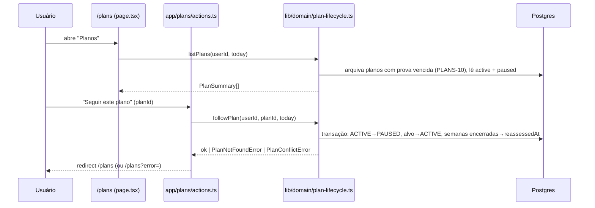
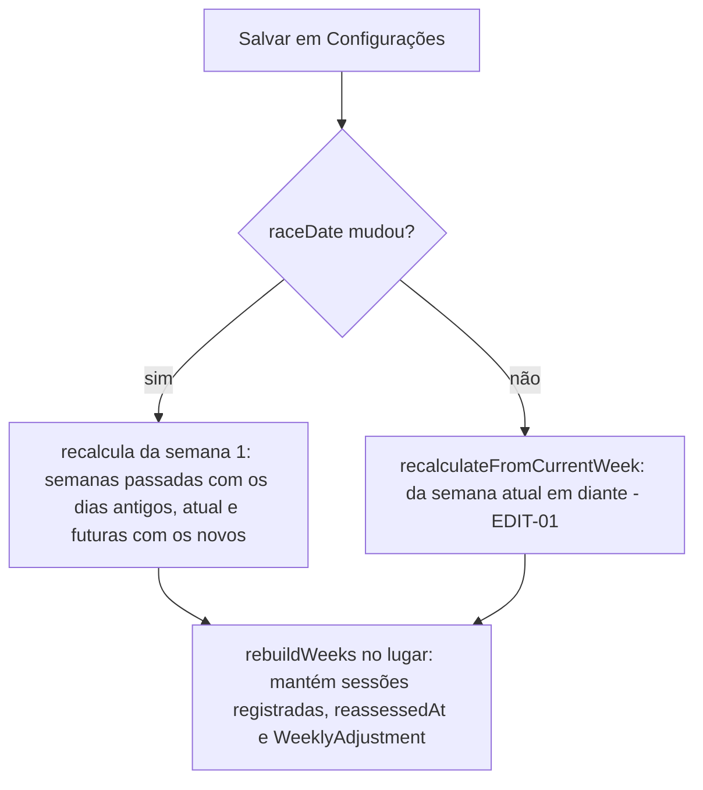

# Gestão de Planos Design

**Spec**: `.specs/features/gestao-de-planos/spec.md`
**Status**: Approved (delegado ao agente, ver `context.md` → Agent's Discretion)

---

## Architecture Overview

A feature segue `AD-001`: toda regra nova vive em `lib/domain/plan-lifecycle.ts` e
`lib/domain/workout-log.ts`; as Server Actions novas validam com zod, chamam uma função do domínio e
redirecionam (com `?error=` quando o domínio recusa). Uma tela nova, `/plans`, lista os planos não
arquivados. As confirmações de exclusão usam um componente cliente com `<dialog>`.





---

## Code Reuse Analysis

### Existing Components to Leverage

| Component | Location | How to Use |
| --- | --- | --- |
| `recalculateFromCurrentWeek` | `lib/domain/plan-lifecycle.ts` | O corpo vira `rebuildWeeks(tx, plan, { fromWeek, totalWeeks, daysFor })`, compartilhado com `editPlan` |
| `createPlan` / `createNewPlan` | `lib/domain/plan-generator.ts`, `plan-lifecycle.ts` | `createPlan` pausa o plano `ACTIVE` dentro da sua transação; `createNewPlan` checa o limite |
| `archiveIfPast` | `lib/domain/plan-lifecycle.ts` | Passa a arquivar `PAUSED` também; `archivePastPlans` aplica a todos os planos do usuário |
| `isWeekDue` | `lib/domain/weekly-adjustment.ts` | Mesmo critério de "semana encerrada" para `PLANS-09` (dia de fim < hoje) |
| `computeSignals` | `lib/domain/weekly-adjustment.ts` | Já conta só as sessões que existem: `DEL-09` sai de graça ao apagar a sessão |
| Mock em memória do Prisma | `lib/domain/plan-lifecycle.test.ts` | Ganha `updateMany`, `count`, `findMany`, `delete`, `deleteMany` e um `matches(where)` genérico |
| `SubmitButton`, `.btn-danger`, `.card`, `.chip-*`, `.alert` | `components/`, `app/globals.css` | Botões, cards e alertas das telas novas |
| `seedActivePlan`, `resetPlans`, `logWorkout`, `login` | `e2e/helpers.ts` | `seedActivePlan` ganha `raceInDays` para planos curtos |

### Integration Points

| System | Integration Method |
| --- | --- |
| `PlanStatus` (Postgres enum) | Nova migração `ALTER TYPE "PlanStatus" ADD VALUE 'PAUSED'` |
| Índice `Plan_userId_active_key` | Revisado: `UNIQUE (userId) WHERE status = 'ACTIVE'` já permite vários `PAUSED`/`ARCHIVED` e continua garantindo `PLANS-02`/`PLANS-13`. Sem mudança. |
| `WorkoutLog.notes` | Coluna já existe (`String?`); só passa a ser escrita |
| Painel `/dashboard` | Troca `archiveIfPast(active)` por `archivePastPlans(userId)`; estado vazio ganha link para `/plans` |
| Configurações `/settings` | Link "Planos"; `updatePlanSettings` chama `editPlan` |
| Histórico `/history` | Rótulo "pausado"; "Excluir plano" para o plano arquivado selecionado |
| Tela do treino `/dashboard/log/[id]` | Campo "Observação"; "Excluir treino" |

---

## Components

### Domínio de planos (`lib/domain/plan-lifecycle.ts`)

- **Purpose**: Ciclo de vida de vários planos: limite, troca, arquivamento, exclusão e recálculo.
- **Interfaces**:
  - `PLAN_LIMIT = 3`, `PLAN_LIMIT_ERROR = "Você já tem 3 planos. Exclua um para criar outro."`
  - `class PlanLimitError`, `class PlanConflictError`, `class PlanNotFoundError`, `class SessionNotFoundError`
  - `createNewPlan(input)` - recusa com `PlanLimitError` quando `active + paused >= 3` (`PLANS-01/03`);
    `createPlan` pausa o `ACTIVE` na mesma transação (`PLANS-04`); `P2002` → `PlanConflictError`
    (`PLANS-13`). Substitui `ActivePlanExistsError` (`LIFE-06`, superado por `AD-005`).
  - `archiveIfPast(planId, today)` - também arquiva `PAUSED` (`PLANS-10`).
  - `archivePastPlans(userId, today): Promise<void>` - arquiva todo `ACTIVE`/`PAUSED` com prova antes de hoje.
  - `listPlans(userId, today): Promise<PlanSummary[]>` - chama `archivePastPlans`, devolve
    `{ id, raceType, raceDate, weeks, status }` dos `ACTIVE`/`PAUSED`, o `ACTIVE` primeiro (`PLANS-05`).
  - `followPlan(userId, planId, today): Promise<"active" | "archived">` - plano do usuário em
    `PAUSED`, senão `PlanNotFoundError` (`PLANS-14`); prova vencida → arquiva; senão numa transação
    pausa o `ACTIVE`, ativa o alvo e grava `reassessedAt` nas semanas dele com fim antes de hoje,
    sem `WeeklyAdjustment` (`PLANS-06/09`); `P2002` → `PlanConflictError` (`PLANS-13`).
  - `deletePlan(userId, planId): Promise<void>` - plano do usuário (qualquer status), senão
    `PlanNotFoundError`; numa transação apaga registros, ajustes, sessões, semanas, histórico de
    VDOT, resultado e o plano (`DEL-02`); não toca outros planos (`DEL-04`).
  - `deleteSession(userId, sessionId): Promise<void>` - sessão de um plano `ACTIVE` do usuário,
    senão `SessionNotFoundError`; última sessão da semana → `LAST_SESSION_ERROR = "A semana precisa
    de pelo menos um treino."` (`DEL-10`); senão apaga o `WorkoutLog` e a sessão (`DEL-08`).
  - `editPlan(planId, { raceDate, days }, today)` - data igual (mesmo dia UTC) → `recalculateFromCurrentWeek`
    com os dias; data diferente → recálculo da semana 1 em diante (`RECALC-01`): semanas antes da
    atual com os dias que o plano já tinha, da atual em diante com os novos.
  - `rebuildWeeks` (interno) - refaz no lugar: atualiza a fase, apaga as sessões sem registro,
    gera as do dia que não tem registro (`RECALC-02`), paces do `currentVdot` (`RECALC-03`),
    mantém `reassessedAt` e `WeeklyAdjustment` (`RECALC-04`), cria semanas que faltam e apaga as
    sem registro além do novo fim. `RECALC-05` reusa `RACE_DATE_ERROR`.
- **Reuses**: `createPlan`, `splitPhases`, `generateSessions`, `computePlanWeeks`, `reassessIfDue`.

### Observação (`lib/domain/workout-log.ts`)

- **Interfaces**:
  - `NOTES_MAX = 500`, `NOTES_ERROR = "Observação inválida: no máximo 500 caracteres."`
  - `parseNotes(raw: string | null | undefined): string | null` - aparado; vazio → `null`
    (`NOTE-03`); mais de 500 caracteres → lança `NOTES_ERROR` (`NOTE-02`).
  - `WorkoutLogInput` ganha `notes: string | null`; `saveWorkoutLog` grava no create e no update (`NOTE-01`).

### Confirmação (`components/confirm-dialog.tsx`)

- **Purpose**: Botão "Excluir ..." que abre um `<dialog>` modal com o texto exato do spec,
  "Cancelar" (fecha, nada muda - `DEL-03`) e "Excluir" (envia a Server Action).
- **Interfaces**: `ConfirmDialog({ label, message, confirmLabel, action })`.
- **Reuses**: `.btn-danger`, `.btn-secondary`, `SubmitButton`; CSS `.dialog` novo em `globals.css`.

### Tela "Planos" (`app/plans/page.tsx` + `app/plans/actions.ts`)

- **Purpose**: Lista os planos (`PLANS-05`) com "Seguir este plano" nos pausados (`PLANS-06`) e
  "Excluir plano" em todos (`DEL-01/05`); link "Novo plano".
- **Actions**: `followPlanAction(planId)`, `deletePlanAction(planId, from)` - zod `z.string().min(1)`,
  domínio, `revalidatePath`, redirect.

### Telas alteradas

- `app/dashboard/page.tsx` - `archivePastPlans`; estado vazio com "Ver meus planos" quando há
  `PAUSED` (`PLANS-11`); observação no card (`NOTE-05`). O painel só lê o `ACTIVE`, então semanas e
  reteste de planos pausados ficam de fora (`PLANS-07/08`).
- `app/settings/page.tsx` - link "Planos" nos dois estados (`PLANS-12`); `actions.ts` chama `editPlan`.
- `app/history/page.tsx` - rótulo do status e `ConfirmDialog` para o plano arquivado (`DEL-05/06`).
- `app/dashboard/log/[sessionId]/page.tsx` + `actions.ts` - textarea "Observação" (`NOTE-01/04`),
  `ConfirmDialog` "Excluir treino" (`DEL-07`) quando o plano da sessão é `ACTIVE`.
- `app/plan/new/actions.ts` - mostra `PlanLimitError`/`PlanConflictError` no formulário (`PLANS-03`).

---

## Data Models

```prisma
enum PlanStatus {
  ACTIVE
  PAUSED   // novo: salvo, não seguido (AD-005)
  ARCHIVED
}
```

```sql
-- prisma/migrations/20261110120000_add_paused_plan_status/migration.sql
ALTER TYPE "PlanStatus" ADD VALUE 'PAUSED';
```

Nenhuma FK muda: as exclusões apagam os filhos explicitamente numa transação, para que o recálculo
(que apaga semanas) nunca leve um registro junto por cascata.

---

## Error Handling Strategy

| Error Scenario | Handling | User Impact |
| --- | --- | --- |
| 4º plano | `PlanLimitError` → `backToForm` | Alerta "Você já tem 3 planos. Exclua um para criar outro." |
| Dois pedidos ativando planos | índice parcial → `P2002` → `PlanConflictError` | Alerta "Seus planos mudaram em outro pedido. Tente de novo." |
| Plano/sessão de outro usuário ou inexistente | `PlanNotFoundError` / `SessionNotFoundError`, nada muda | `/plans?error=Plano não encontrado.` / painel com "Treino não encontrado." |
| Última sessão da semana | `LAST_SESSION_ERROR` | Alerta na tela do treino |
| Data da prova antes da semana atual | `RACE_DATE_ERROR` | Alerta em Configurações |
| Observação > 500 | `NOTES_ERROR` via zod `superRefine` com `parseNotes` | Alerta no formulário de registro |

---

## Risks & Concerns

| Concern | Location (file:line) | Impact | Mitigation |
| --- | --- | --- | --- |
| Recálculo atual apaga e recria semanas ≥ atual, perdendo `reassessedAt` | `lib/domain/plan-lifecycle.ts:170` | Refazer semanas passadas assim reavaliaria de novo (`ADJ-06`) e quebraria a FK de `WeeklyAdjustment` | `rebuildWeeks` atualiza no lugar; só apaga semanas sem registro além do novo fim |
| Teste `createNewPlan rejects a second active plan` codifica `LIFE-06` | `lib/domain/plan-lifecycle.test.ts:328` | Fica errado pelo spec novo (`PLANS-04`, `AD-005`) | Reescrito em T3 para o comportamento novo; mudança registrada no commit |
| Painel tem regra na página (laço de reavaliação, semana atual) | `app/dashboard/page.tsx:88` | Fora do alcance do Vitest | Coberto por e2e (como já é); a feature não acrescenta regra ali, só troca a função de arquivamento |
| Página de registro não confere o dono da sessão | `app/dashboard/log/[sessionId]/page.tsx:26` | Conta única: sem impacto real | `deleteSession` confere dono e status (`PLANS-14`) |
| Mock do Prisma em memória não valida FKs reais | `lib/domain/plan-lifecycle.test.ts:118` | Exclusão em cascata poderia passar no unit e falhar no banco | e2e de `DEL-02` conta as linhas no banco de dev |

---

## Tech Decisions

| Decision | Choice | Rationale |
| --- | --- | --- |
| Pausar o plano anterior | Dentro da transação de `createPlan` | Se a criação falha, o anterior continua `ACTIVE` |
| Recálculo quando só os dias mudam | Continua `EDIT-01` (da semana atual) | Fora de escopo mudar (`spec.md` → Out of Scope) |
| Dias das semanas passadas no recálculo total | Os que o plano tinha antes da edição | Mudar os dias segue `EDIT-01`; só a data refaz o passado |
| Confirmação | `<dialog>` modal nativo | Acessível (role `dialog`), sem dependência, estilizável com os tokens Passo Ritmo |
| Exclusão em cascata | Deletes explícitos em transação, sem `onDelete: Cascade` | Ver Data Models |
